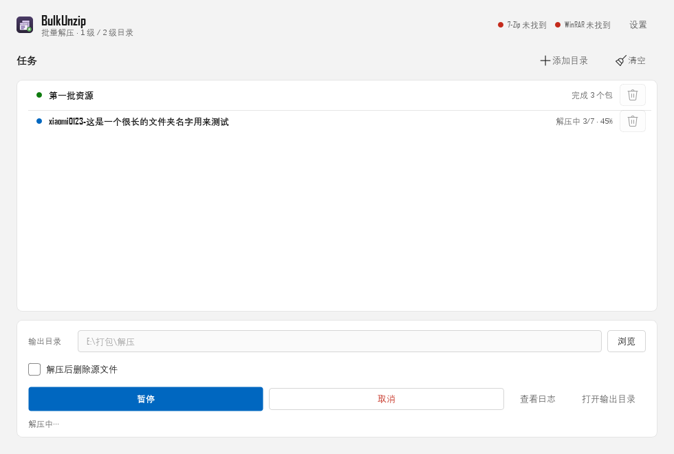
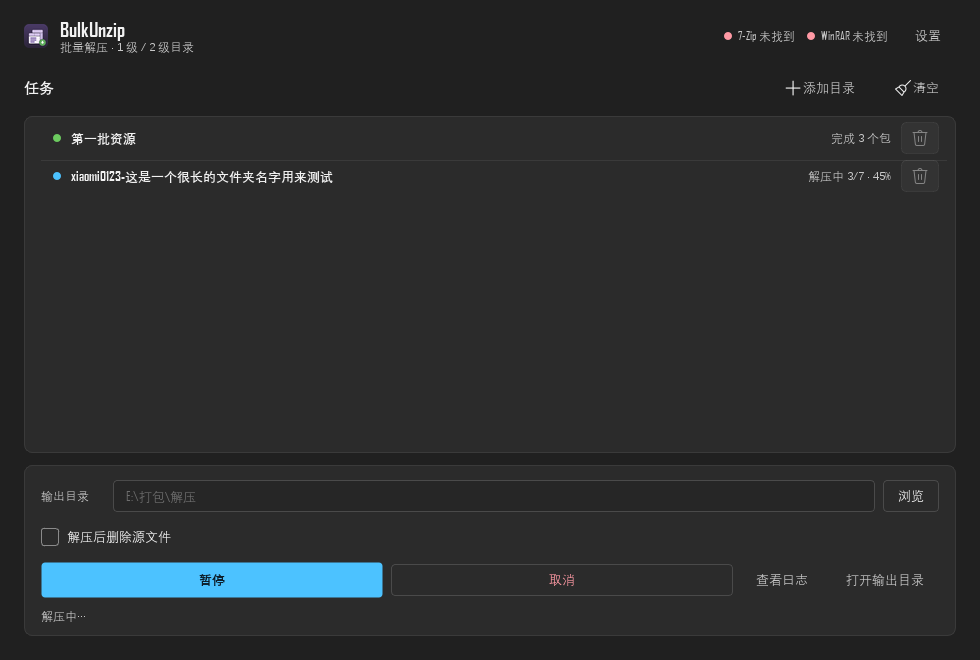

# BulkUnzip

**批量解压：把 1 级目录下各 2 级目录里的压缩包，解开到输出目录的同名两层文件夹。**



深色主题（设置里可选浅色 / 深色 / 跟随系统）：



```
输入（1 级目录 / 2 级目录 / 压缩包）        输出（1 级目录 / 2 级目录 / 解压结果）
资料/                                       解压结果/
├── 第一批/                                  ├── 第一批/
│   ├── a.zip                                │   ├── a/        ← 或直接放文件
│   └── b.7z                                 │   └── b/
└── 第二批/                                  └── 第二批/
    └── c.rar                                    └── c/
```

## 规则

- **1 级、2 级目录名原样保留**，输出里只有这两层文件夹。
- 每个 2 级目录里的压缩包（zip / 7z / rar）**统统解开到该目录**；按文件头识别，改过后缀的也能认。
- 压缩包内只有**一层外壳文件夹**时剥掉这一层，文件直接落在 2 级目录。
- 与已有内容**重名**时按系统习惯追加序号（`名称 (2).txt`），不覆盖。
- 可勾选「解压后删除源文件」：一个 2 级目录的压缩包全部解开后才删除这些源包，目录清空后一并移除；有包解不开时保留原文件。
- 单个压缩包失败只记录，不中断其余任务。

## 使用

界面是 Windows 11 Fluent 风格：顶部为名称与工具状态，中间是任务面板（状态点 + 目录名 + 状态 + 移除），底部为输出与操作面板；支持浅色、深色和跟随系统三种主题（设置里切换，立即生效）。

1. 把 1 级目录拖进窗口（或点「添加目录」）。
2. 选择输出目录，按需勾选「解压后删除源文件」。
3. 点「开始解压」，每行显示正在解压的**当前压缩包百分比**和**已完成的包数**（如 `解压中 3/7 · 45%`）；完成后可双击该行打开输出目录。
4. 运行中可以「暂停 / 继续」；点「取消」会先弹确认（默认按钮是"继续解压"），确认后当前压缩包作废、后续不再处理。

解压结果、重命名清单和失败原因会在完成后弹窗；「查看日志」保留完整过程，日志框跟随主题配色。

## 运行环境

- Windows 10/11。
- 需要系统里装有 **7-Zip**（`7z.exe`，解 zip / 7z）和 **WinRAR**（`Rar.exe`，解 rar）。
- 程序会在自己的目录、`dependencies\7z|winrar`、常见安装目录和 `PATH` 中自动查找；也可以在「设置」里手动指定。

## 源码运行

```powershell
python -m venv .venv
.venv\Scripts\pip install -r requirements.txt
.venv\Scripts\python main.py
```

## 构建

```powershell
.venv\Scripts\pip install pyinstaller
.venv\Scripts\python scripts\build.py
```

产物在 `dist\BulkUnzip.exe`（单文件，自带 Python 运行时）。

## 许可

本项目基于 GPL-3.0-only 发布，解压引擎与界面取自 [NestPack](https://github.com/codeTianZun/NestPack)（GPL-3.0-only）的批量解压部分。
